# FDV-2D-2627

## Ejercicio 1

Agregar el atlas de sprites del personaje a la escena. Configurar el sprite como múltiple y subdividirlo para tener acceso a los sprites para generar las animaciones. Agregar una de las imágenes a la escena.

***Como el propio enunciado indica, se importó el atlas de sprites del personaje al proyecto y se configuró para que se tenga acceso a los diferentes sprites que componen la animación del personaje.***

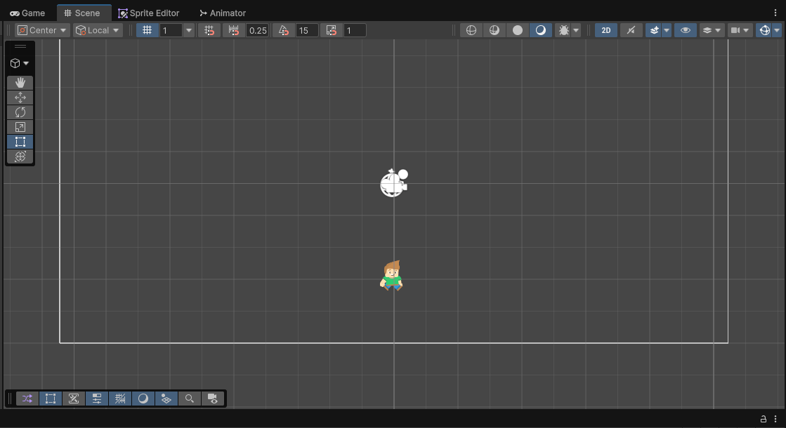

## Ejercicio 2

Creamos un objeto 2D, arrastrando un conjunto de imágenes que selecciones al objeto añadiremos una animación. Agregar al personaje la animación “Walk Down” . Añadir otra imagen y generarle otra animación.  De esa forma Unity crea un objeto Animation, la primera vez que se crea, también añade un objeto Animator Controller.

***Para este ejercicio seleccioné un par de sprites del personaje y se los asigné a la animación "Walk Down". Luego elegí otro par de sprites para crear otra animación que correspondería a "Idle". Por lo tanto, se puede observar que se crearon las dos animaciones y el objeto Animator Controller que permite controlar las transiciones entre ellas.***

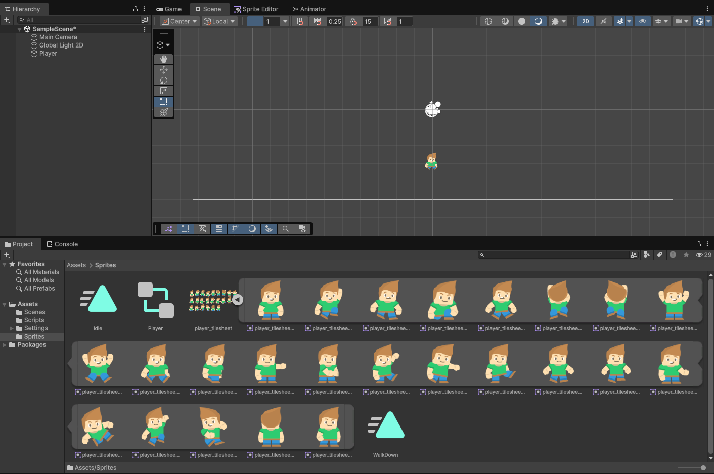

## Ejercicio 3, 4 y 5

3. Creamos los scripts para controlar el movimiento para el personaje. Inicialmente vamos a hacer una versión sin salto. Añadir los scripts necesarios para moverlo por la pantalla. En este caso sólo tendremos que mover las coordenadas (X, Y).  El movimiento de derecha a izquierda lo logramos modificando transform.position(x, y), para ello podemos usar transform.Translate(avance, 0).

4. Controlar el movimiento por teclado: el avance se produce si el jugador ha pulsado las teclas flecha izquierda o flecha derecha.

5. Necesitarás las instrucciones:

    ```csharp
    float horizontalInput = Input.GetAxis("Horizontal"); 
    Vector2 movement = new Vector2(horizontalInput, 0f); 
    transform.Translate(movement * speed * Time.deltaTime);
    ```

***En este conjunto de ejercicios se creó un script llamado "CharacterMovement" que permite controlar el movimiento del personaje en la escena. Se implementó la lógica para mover al personaje hacia la izquierda y hacia la derecha utilizando las teclas A y D (para el cual se necesitó cambiar el tipo de Input Handling al antiguo para poder usar Input.GetAxis) respectivamente mediante `transform.Translate`, tal y como se ve en el script:***

```csharp
public class CharacterMovement : MonoBehaviour
{
    [SerializeField] private float speed = 5f;

    void Update()
    {
        float horizontalInput = Input.GetAxis("Horizontal");
        Vector2 movement = new Vector2(horizontalInput, 0f);
        transform.Translate(movement * speed * Time.deltaTime);
    }
}
```

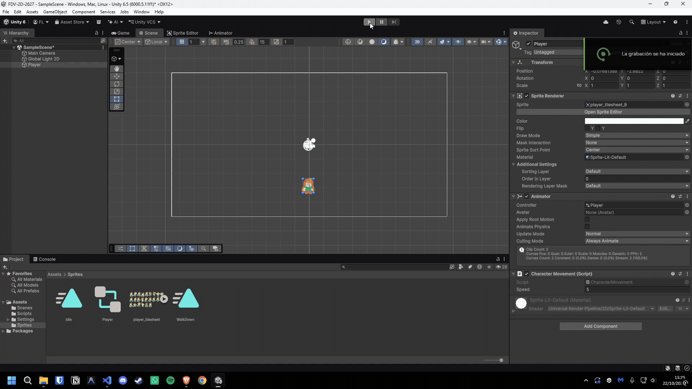

## Ejercicio 6

Además necesitamos que el sprite se oriente hacia donde camina, podemos hacerlo usando la propiedad Flip en el eje X en función de si se está moviendo hacia la izquierda (movimiento negativo) o hacia la derecha (movimiento positivo):

- Obtener el componente SpriteRenderer para poder modificar el sprite. Deberías hacerlo sólo una vez.
- Comprobar la dirección del movimiento usando el valor de horizontalInput. 
- Usar una condición if para saber si el personaje se mueve a la derecha.
- Usar una condición else if para saber si se mueve a la izquierda.
- SpriteRenderer spriteRenderer;
- spriteRenderer.flipX

***Para este ejercicio se modificó el script "CharacterMovement" para que el sprite del personaje se oriente hacia la dirección en la que se mueve. Se agregó un componente `SpriteRenderer` y se utilizó la propiedad `flipX` para voltear el sprite según la dirección del movimiento. A continuación, se muestra el código actualizado:***

```csharp
public class CharacterMovement : MonoBehaviour
{
    [SerializeField] private float speed = 5f;
    private SpriteRenderer sr;

    void Start()
    {
        sr = GetComponent<SpriteRenderer>();
    }

    void Update()
    {
        float horizontalInput = Input.GetAxis("Horizontal");

        if (horizontalInput > 0)      sr.flipX = false; // Face right
        else if (horizontalInput < 0) sr.flipX = true;  // Face left

        Vector2 movement = new Vector2(horizontalInput, 0f);
        transform.Translate(movement * speed * Time.deltaTime);
    }
}
```

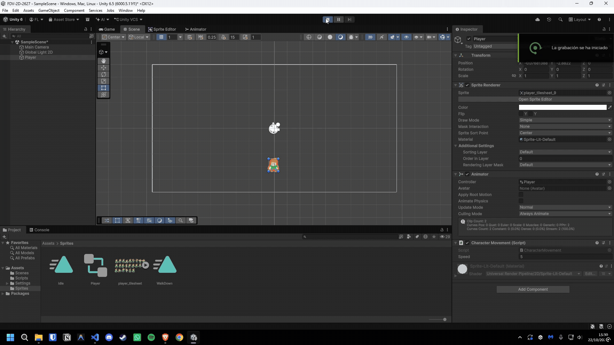

## Ejercicio 7

Crear las animaciones del personaje: Para cada animación que queramos agregar a un objeto seleccionamos la colección de sprites que forman la animación y la arrastramos hasta él. Agregaremos todas las animaciones al personaje. El objeto Animator Controller las gestiona en la ejecución.
Con la animación seleccionada podemos arrastrar el objeto jugador e ir visualizando las animaciones.

En la pestaña Animator disponemos de una interfaz gráfica que nos permite definir de forma visual la máquina de estados que controla la animación. Por defecto, del estado inicial (Entry) se pasa a la animación Idle. Las transiciones pueden estar controladas por parámetros que nos permitirán definir scripts asociados controlados por valores que tome el parámetro.

```csharp
private Animator animator;
animator = GetComponent<Animator>();
animator.SetBool("isWalking", true);
```

Crear un script, en el que el personaje, después de caminar una distancia determinada cambie la animación. Para ello, debes:

- Declarar una variable para ir actualizando en cada frame la distancia recorrida. 
- Una variable que le puedas dar el valor que quieras que active el cambio, si la variable distancia supera el valor, se tiene que pasar a otra animación
- Obtener una referencia al Animator: Tienes que acceder al componente Animator sólo una vez para utilizarlo en el código. Debes obtener una referencia a él en tu script para poder controlar el cambio de una animación a otra.
- En cada frame debes calcular cuánto se ha movido el personaje desde la posición inicial.
- Si la distancia total recorrida supere la distancia de activación, tu script debe indicarle al Animator que reproduzca la nueva animación.
- Calcular la distancia que hay entre la posición actual y la que anterior

```csharp
float distanceThisFrame = Vector3.Distance(firstPosition, transform.position);
```

***Para lograr esto, se creó un script llamado "CharacterAnimation" que controla la animación del personaje en función de la distancia recorrida. Se utiliza un parámetro booleano "isWalking" en el Animator para cambiar entre las animaciones de caminar y estar quieto. A continuación, se muestra el código del script:***

```csharp
public class CharacterAnimation : MonoBehaviour
{
    [SerializeField] private float activationDistance = 0.0001f;

    private Animator animator;
    private Vector3 firstPosition;

    void Start()
    {
        animator = GetComponent<Animator>();
        firstPosition = transform.position;
    }

    void Update()
    {
        float distanceThisFrame = Vector2.Distance(firstPosition, transform.position);

        if (distanceThisFrame >= activationDistance)
        {
            animator.SetBool("isWalking", true);
        }
        else
        {
            animator.SetBool("isWalking", false);
        }

        firstPosition = transform.position;
    }
}
```

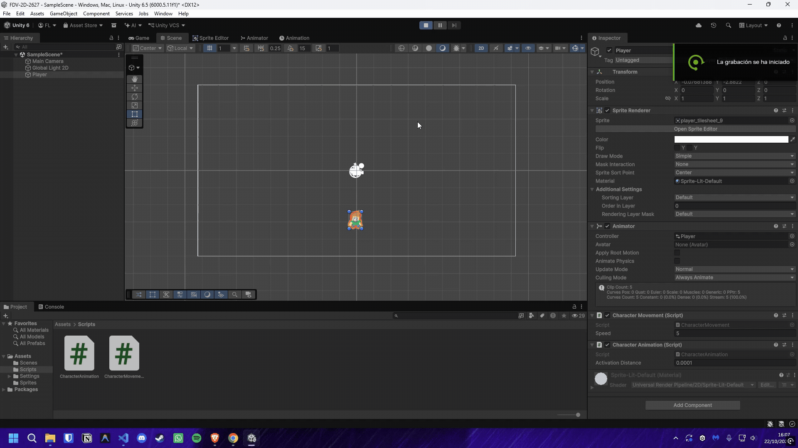
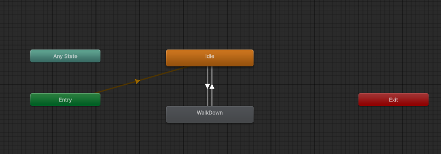

## Ejercicio 8

Experimenta con el concepto de PPU: Abre el Sprite Editor y anota el tamaño en píxeles de uno de los sprites del personaje (ancho × alto).  En el Inspector del atlas, busca el valor de Pixels Per Unit. ¿Cuál tiene por defecto? Calcula cuántas unidades medirá el personaje en la escena. Comprueba tu cálculo: añade al personaje un BoxCollider2D y mira su propiedad Size, o compáralo con la cuadrícula de la vista Scene (cada celda es 1 unidad). Cambia el PPU a 16, 32 y 100, pulsando Apply cada vez. Anota cuánto mide el personaje en cada caso. Al cambiar el PPU, ¿ha cambiado la imagen? ¿Qué ha cambiado entonces?. Elige un PPU para que el personaje mida entre 1 y 2 unidades de alto. ¿Qué valor has elegido y por qué?

***El sprite elegido tiene un tamaño de 74x99 píxeles, el Atlas tiene configurado el PPU en 100, por lo que el personaje mide 0.65 unidades de ancho y 0.98 unidades de alto. Al añadir un BoxCollider2D, se puede observar que el tamaño del collider es de 0.74x0.99 unidades, lo cual es consistente con el tamaño del sprite.***

***Al cambiar el PPU a 16, 32 y 100, se observa que la imagen del sprite no cambia, pero sí cambia el tamaño del personaje en la escena. Se eligió un PPU de 50 para que el personaje mida aproximadamente casi 2 unidades de alto, este valor viene dado que 74 píxeles dividido por 50 es igual a 1.48 unidades de ancho, y 99 píxeles dividido por 50 es igual a 1.98 unidades de alto.***

## Ejercicio 9

Añade a la escena un segundo objeto con otro sprite de los recursos y ponle un PPU distinto al del personaje.Ajusta la Scale de su Transform hasta que los dos objetos tengan un tamaño parecido en pantalla. Haz zoom en la vista Game y compara el tamaño de los píxeles de ambos sprites.Si los píxeles se ven borrosos, selecciona el atlas y pon Filter Mode = Point (no filter) y Compression = None. Es la configuración que necesita cualquier juego de pixel art. ¿Los píxeles de los dos sprites tienen el mismo tamaño?.¿Qué regla deberían cumplir todos los sprites de un juego para que esto no ocurra?

***De los recursos otorgados, decidí agregar el sprite de lo que parece un bol de madera o una maceta, con un PPU de 100. Ajusté la escala del objeto para que tenga un tamaño similar al del personaje. Al hacer zoom en la vista Game, se puede observar que los píxeles de ambos sprites no tienen el mismo tamaño, dado que el sprite del personaje tiene un PPU de 50 y el sprite del bol tiene un PPU de 100. Para que los píxeles de todos los sprites tengan el mismo tamaño, todos los sprites del juego deberían tener el mismo valor de PPU.***

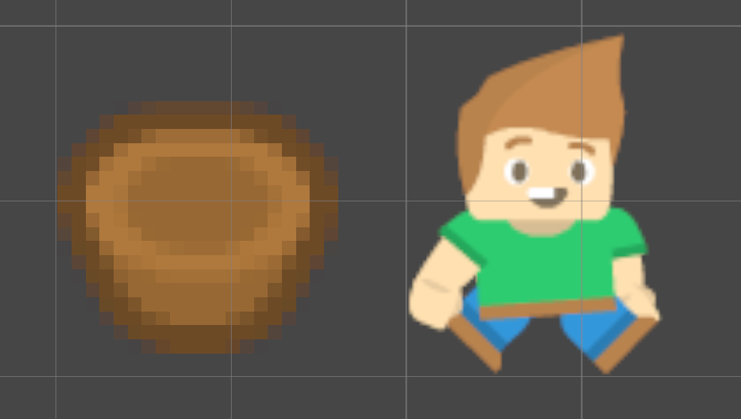

## Ejercicio 10

Selecciona la Main Camera y comprueba que Projection es Orthographic. Anota su Size. Antes de comprobarlo, calcula cuántas unidades se ven en vertical. Comprueba tu cálculo: coloca dos objetos en y = +size e y = −size. ¿Quedan justo en los bordes de la vista Game? En el desplegable de resolución de la vista Game, cambia entre 16:9, 4:3 y una resolución panorámica (por ejemplo 2560×1080). Observa qué cambia y qué se mantiene. Cambia el Size a 2 y a 10. ¿Cómo cambia el tamaño del personaje en pantalla? Al cambiar la relación de aspecto, ¿qué dimensión se mantiene fija y cuál cambia?Con Size = 5, calcula la anchura visible en 16:9 y en 4:3. Si dos jugadores juegan con monitores distintos, ¿ven la misma cantidad de nivel? ¿En qué tipo de juego sería un problema?

***El size puesto en la Main Camera por defecto es de 5, por lo que se pueden ver 10 unidades en vertical. Al colocar dos objetos en y = +size e y = −size, estos quedan con la mitad de su altura fuera de la vista Game, dado que el pivot de los objetos se encuentra en el centro de los mismos. Al cambiar la relación de aspecto, la altura visible se mantiene fija, mientras que la anchura visible cambia. Con Size = 5, la anchura visible en 16:9 es de aproximadamente 8.89 unidades y en 4:3 es de aproximadamente 6.67 unidades. Si dos jugadores juegan con monitores distintos, no verán la misma cantidad de nivel, lo cual podría ser un problema en juegos multijugador competitivos donde la visibilidad del entorno es crucial para el rendimiento del jugador.***

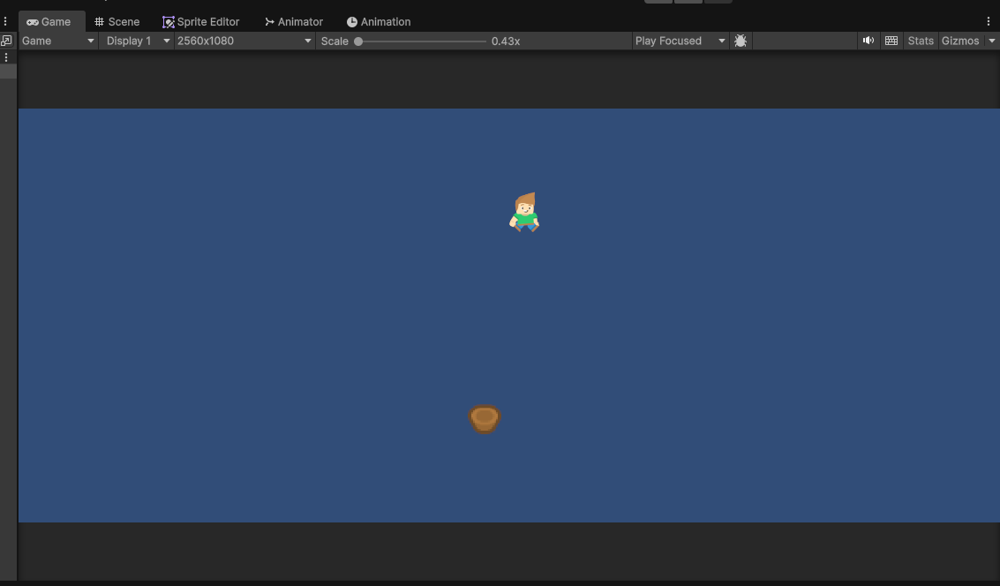
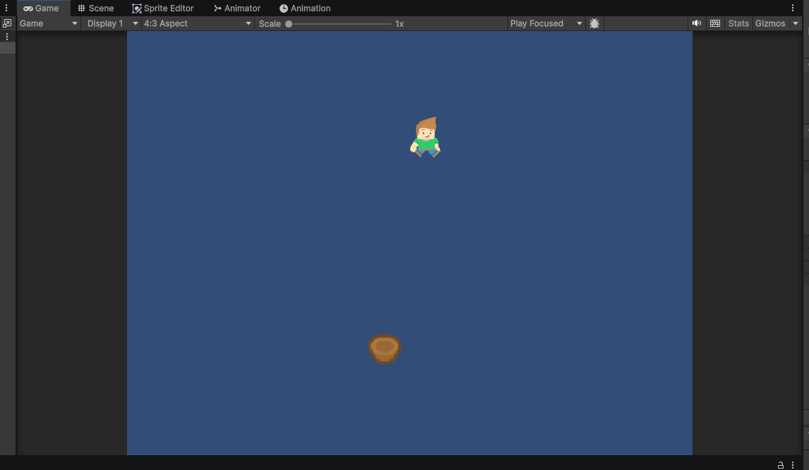
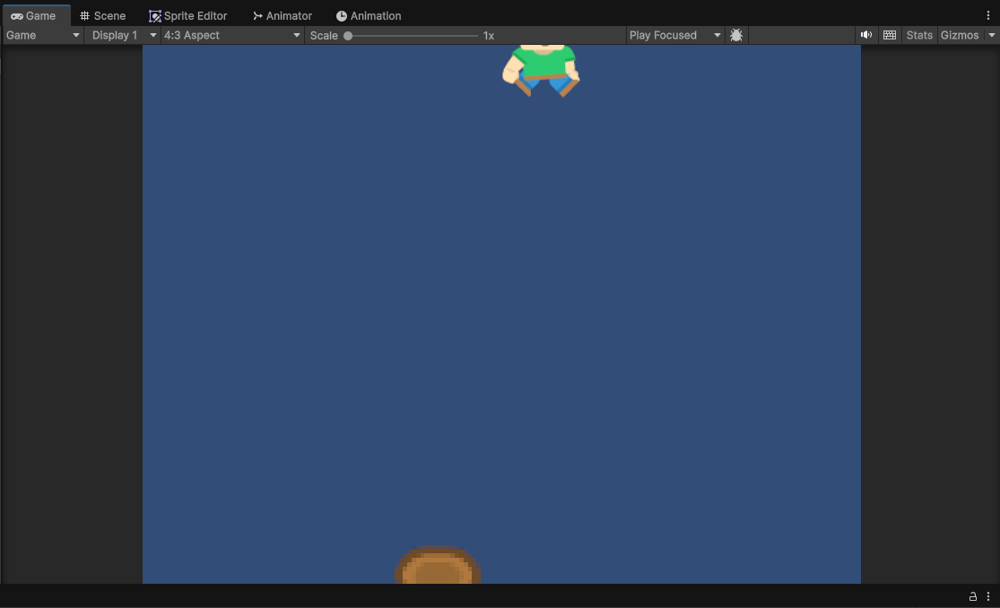
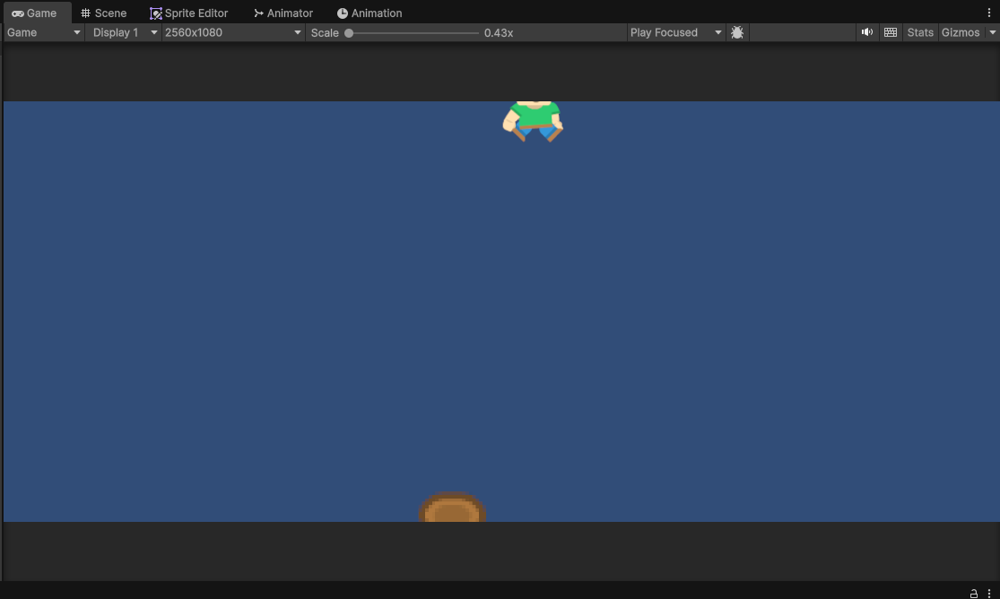